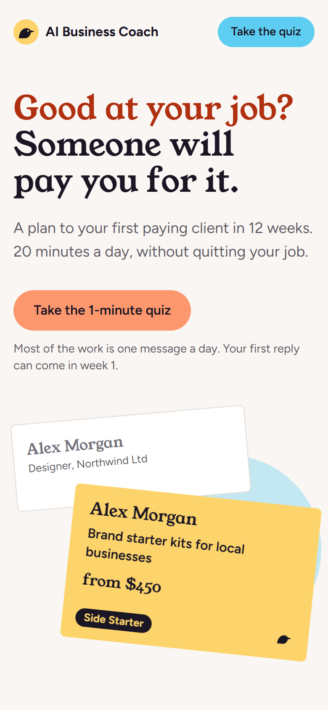
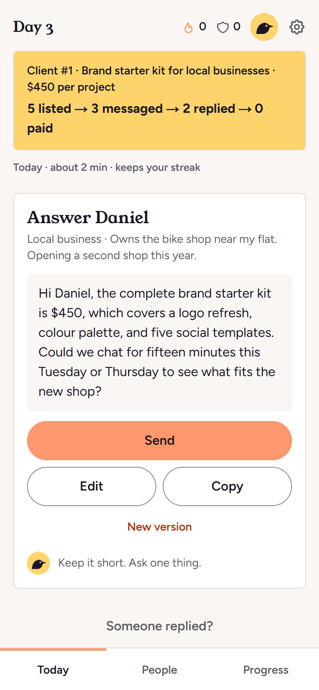
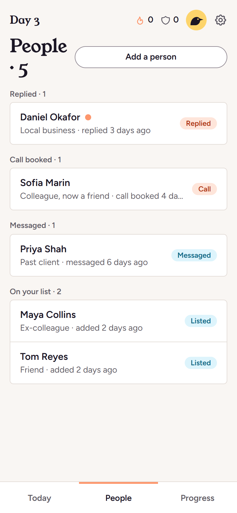
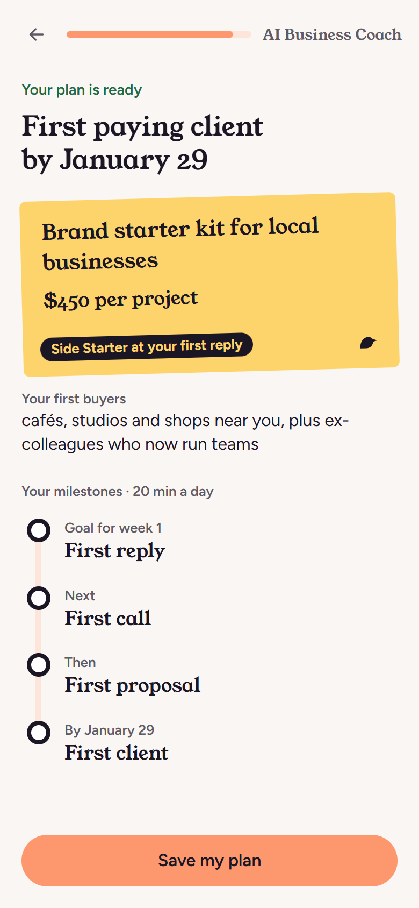
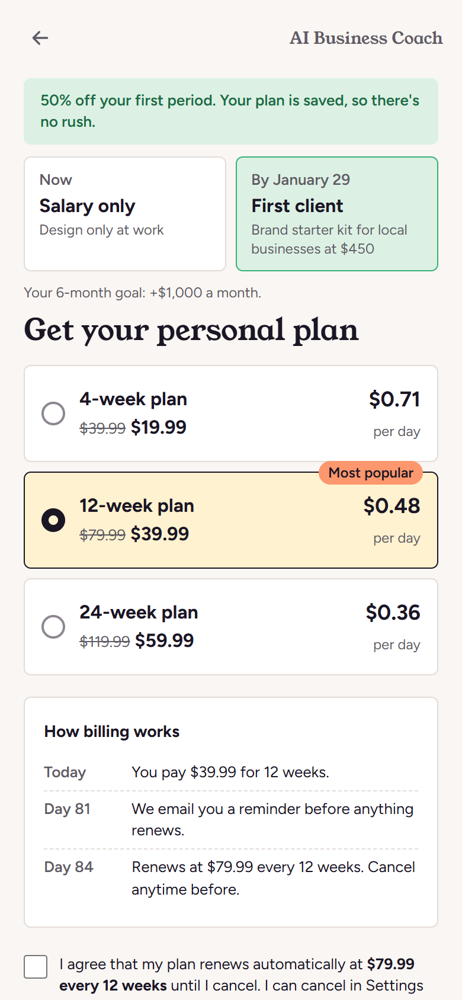
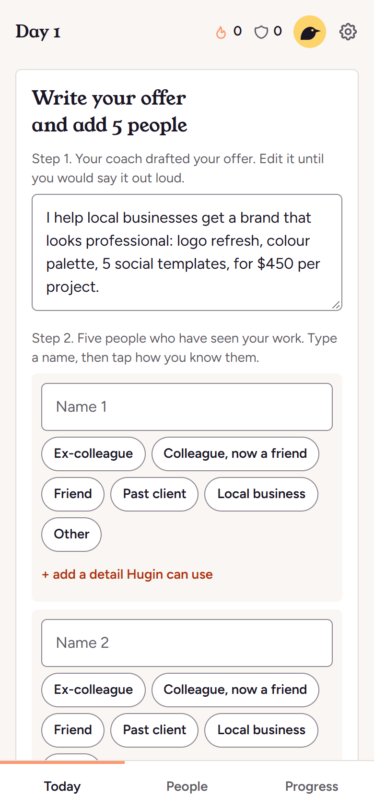
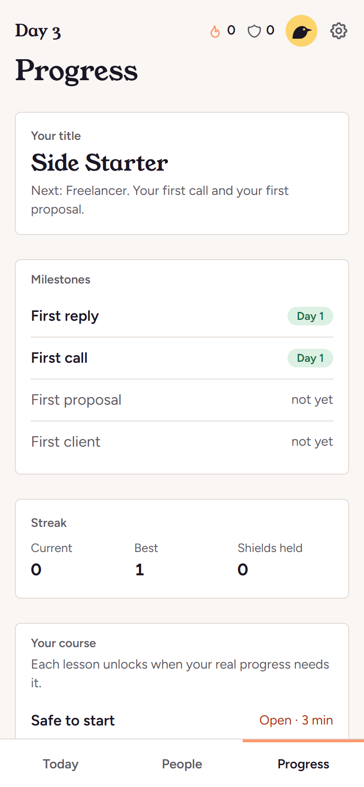

# AI Business Coach

**Good at your job? Someone will pay you for it.**

An AI coach that takes an employed professional from a skill they use at work to a first paying client of their own side service. It is a 12-week plan, built on 20 minutes a day and one message a day, without quitting your job.

Built by Team 4 (Jandos, Temirlan) for the Zimran IT School capstone.

<p align="center">
  
  
  
</p>

## Live links

- **Landing page:** https://ai-business-coach-blush.vercel.app
- **Product (start with the quiz):** https://ai-business-coach-blush.vercel.app/quiz
- **Demo mode:** https://ai-business-coach-blush.vercel.app/quiz?demo=1 adds a screen map to the quiz and demo controls to the app, so you can see a week of progress in a minute.

## What it does

1. **Quiz (`/quiz`):** six questions about your skill, experience, goal, time and main blocker. You get a personal plan before you pay: a service to sell, a starting price, your first buyers and your milestones to a first client.
2. **Paywall and checkout:** 4, 12 and 24-week plans with 50% off the first period, a billing timeline, and an auto-renewal checkbox that is never pre-ticked. The full renewal price is shown before Pay. Checkout is simulated.
3. **The app (`/app`):**
   - **Today:** one step a day, sized to a few minutes. On day 1 you write your offer and add five people. After that, each day is one message, one reply or one follow-up.
   - **People:** your warm list, grouped by stage: listed, messaged, replied, call booked, paid.
   - **Progress:** your title, milestones (first reply, first call, first proposal, first client), streak and nine short lessons that unlock when your real progress needs them.
4. **Hugin, the coach:** a raven with a dry sense of humour. He writes the message for one named person, drafts your replies and answers questions. Titles and streaks follow real events such as a first reply or a first paid client, not tapping through screens.

## Screenshots

| Plan | Paywall |
| --- | --- |
|  |  |

| Day 1 | Today | Progress |
| --- | --- | --- |
|  |  |  |

Screenshots are 390x844 at 2x, taken from the app in demo mode.

## Tech stack

- **Framework:** Next.js 16 (App Router) with React 19 and TypeScript
- **Styling:** Tailwind CSS 4 with design tokens in `src/app/globals.css`, light and dark themes
- **AI:** Google Gemini through the `@google/genai` SDK, called only from server route handlers
- **Animation:** React `<ViewTransition>` for screen changes and sheets, turned off under reduced motion
- **Tests:** Vitest, 149 tests for pricing, the game rules, the next-step logic, contacts, the lessons and Hugin's input handling
- **Hosting:** Vercel

## How the Gemini parts work

Three API routes call Gemini. The API key stays on the server and never reaches the browser.

| Route | What it does | Main model | Backup |
| --- | --- | --- | --- |
| `POST /api/draft` | Writes drafts for the day's step (outreach, replies, follow-ups, proposals) and reviews your lesson decisions, returned as JSON | `gemini-3.5-flash-lite` | `gemini-3.6-flash` |
| `POST /api/verify` | Checks whether a proof screenshot shows the claimed result (a reply, a booking, a payment) and answers in Hugin's voice | `gemini-3.6-flash` | `gemini-3.5-flash-lite` |
| `POST /api/chat` | A streamed chat with Hugin | `gemini-3.5-flash-lite` | `gemini-3.6-flash` |

- **One personality:** every call shares Hugin's system prompt in `src/lib/hugin.ts`. He is calm, uses no exclamation marks, never promises income, gives no legal, tax or medical advice, and never invents shared history with the person a message goes to.
- **Privacy:** the browser sends only what a call needs, such as your service, price and the one person a message is for. The full list is never sent. Screenshots are checked and dropped: only the verdict is saved.
- **Reliability:** if the main model is overloaded or returns nothing, the call retries on the backup model. If Gemini is down, Hugin says so in one line and the step still works.
- **Cost protection:** a per-visitor limit on each route (15 screenshot checks, 30 drafts and 40 chat messages per window) keeps a public link from using up the API quota.

## What the MVP simulates, and why

| Part | In the MVP | Why |
| --- | --- | --- |
| Payments | Apple Pay, Google Pay and card buttons simulate a successful payment. No card details are collected. | The capstone tests the funnel and the product, not a payment provider. |
| Email | The email is stored in the browser and never sent. | No email service is needed to show the flow. |
| Accounts and data | Progress is saved in the browser's `localStorage`. There is no login or database. | Keeps the demo instant and private. A real launch would add accounts. |
| Days | The day count follows the calendar. Missed days use a Streak Shield or become a recovery step. Demo mode can move ahead of the calendar. | Lets the jury see weeks of progress in one session. |

## Run it locally

You need Node.js 22 or newer and a Gemini API key from [Google AI Studio](https://aistudio.google.com/apikey).

```bash
npm install
```

```bash
cp .env.example .env.local
```

Add your key to `.env.local`:

```bash
GEMINI_API_KEY=your_key_here
```

Start the dev server and open http://localhost:3000:

```bash
npm run dev
```

Add `?demo=1` to `/quiz` to get the screen map and the demo controls (next day, miss a day, seed demo people, simulate a reply, unlock all lessons).

If your antivirus scans HTTPS traffic (Avast does) and `npm` or Gemini calls fail with `unable to get local issuer certificate`, tell Node.js to use the Windows certificate store:

```powershell
$env:NODE_OPTIONS = "--use-system-ca"
```

Other commands:

```bash
npm test
```

```bash
npm run build
```

## Project structure

- `src/app/page.tsx`: the landing page
- `src/components/quiz/`: the quiz, plan, paywall, checkout and upsell screens
- `src/components/coach/`: the app: Today, People, Progress, lessons, Hugin's sheets and the demo panel
- `src/app/api/`: the Gemini routes (`draft`, `verify`, `chat`) and a `health` check
- `src/lib/`: plain TypeScript with no React: quiz data, pricing, the game rules, next-step logic, contacts, the nine lessons, storage
- `docs/screenshots/`: the README images; `docs/redesign/`: before and after shots of the visual redesign
